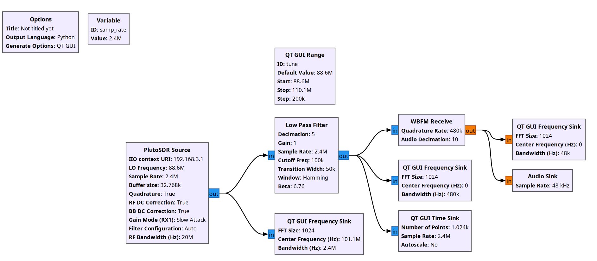
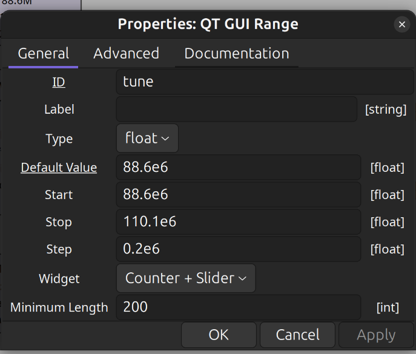
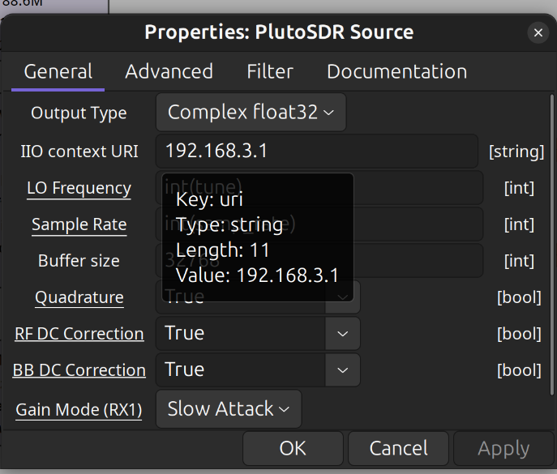
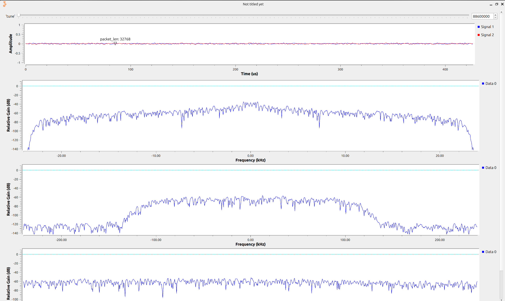

  
Федеральное государственное образовательное бюджетное
учреждение высшего образования
«Сибирский государственный университет телекоммуникаций и
информатики» (ФГОБУ ВО «СибГУТИ»)

  <h1 style="font-size: 36px; margin-top: 40px;">Отчет SDR №1</h1>
  
GNU Radio. Построение радио-приёмника.

  
<b>Выполнил:</b> Студент / Хоробров Георгий ИКС-433

  
<b>Проверил:</b> Преподаватель / Калачиков Александр Александрович

  
Новосибирск — 2026

---

### Создали конфигурацию по методичке

Общая схема 

`QT GUI `

> Создали QT GUI Range для задания частоты радио
> 

`PlutoSDR Source`

> Связали с `QT GUI Range` через `id` и привели к типу `int`. Также указали `ip` SDR: 192.168.3.1 или 192.168.2.1
> 

###### **Low Pass Filter** - пропускает частоты ниже 100 кГц и подавляет все что выше

###### **WBFM Receive** - превращает отфильтрованный сигнал и демодулирует его

###### **Audio Sink** - блок вывода звука на звуковую карту компьютера

### Программа

