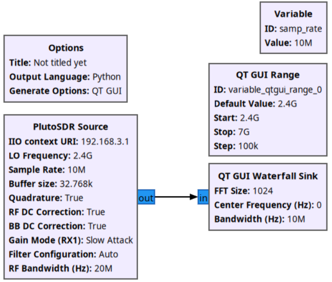
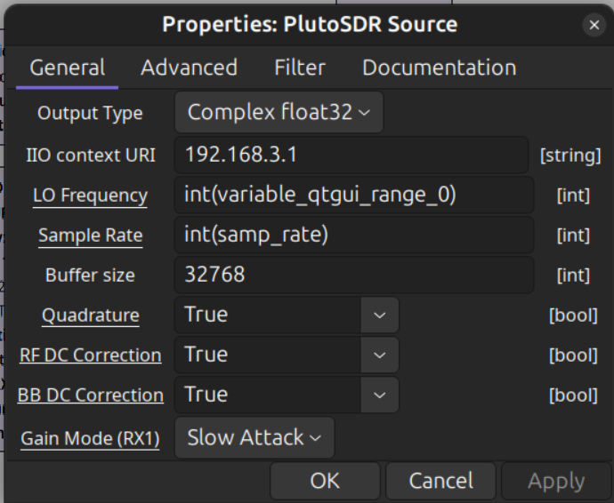
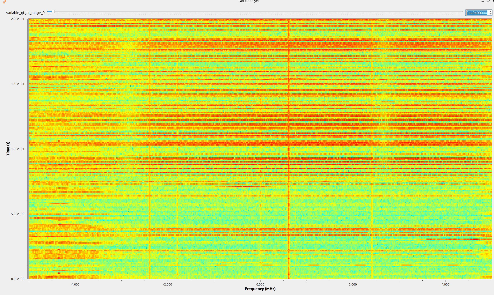
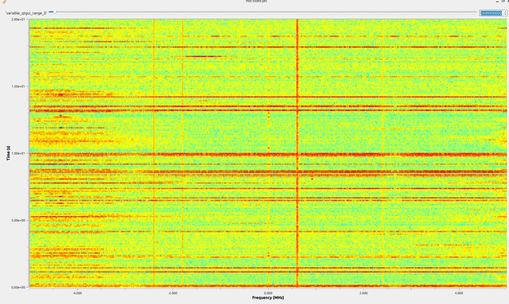

  
Федеральное государственное образовательное бюджетное
учреждение высшего образования
«Сибирский государственный университет телекоммуникаций и
информатики» (ФГОБУ ВО «СибГУТИ»)

  <h1 style="font-size: 36px; margin-top: 40px;">Отчет SDR №2 </h1>
  
## GNU Radio. Построение радио-приёмника, радио-передатчика.

  
<b>Выполнил:</b> Студент / Хоробров Георгий ИКС-433

  
<b>Проверил:</b> Преподаватель / Калачиков Александр Александрович

  
Новосибирск — 2026

---

### Создали конфигурацию

Общая схема

`PlutoSDR Source`

> Связали с `QT GUI Range` через `id` и привели к типу `int`. Также указали `ip` SDR: 192.168.3.1 или 192.168.2.1
> ****

###### **QT GUI Waterfall Sink** - графический приемник, который отображает сигнал виде водопада или спектограммы

###### **QT GUI Range** - элемент управления Gui при помощи, задаем значение `LO Frequency`.

### Программа

> При помощи ползунка настраиваемся на частоту работы Wi-Fi смартфона. При попадании в частотный канал точки доступа на водопаде появляется яркая горизонтальная полоса или отдельные яркие участки - Wi-Fi имеет пакетный характер, поэтому активность выглядит не сплошной линией, а прерывистыми всплесками. Цвет отображает уровень сигнала: красный - высокий уровень сигнала, зелёный или синий - низкий уровень или шум.

