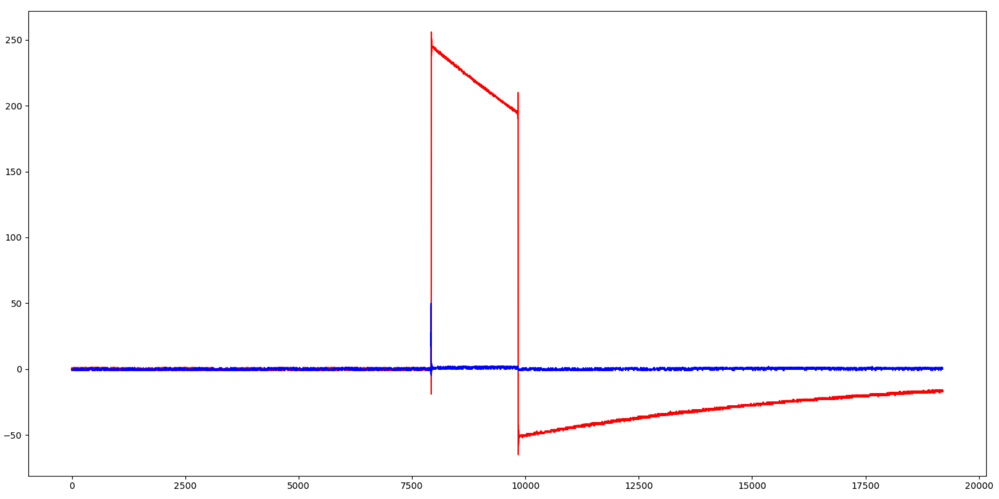

<div style="text-align: center; margin-top: 150px; margin-bottom: 250px;">
  <p style="font-size: 14px; text-transform: uppercase; letter-spacing: 2px;">Федеральное государственное образовательное бюджетное
учреждение высшего образования
«Сибирский государственный университет телекоммуникаций и
информатики» (ФГОБУ ВО «СибГУТИ»)</p>
  <h1 style="font-size: 36px; margin-top: 40px;">Отчет SDR №3 </h1>
  <p style="font-size: 18px; color: gray;">Знакомство с библиотеками Soapy SDR, Libio для работы с Adalm Pluto SDR. Инициализация SDR-устройства. Работа с буфером: получение цифровых IQ-отсчетов.</p>
</div>

<div style="text-align: right; margin-right: 50px;">
  <p><b>Выполнил:</b> Студент / Хоробров Георгий ИКС-433</p>
  <p><b>Проверил:</b> Преподаватель / Калачиков Александр Александрович</p>
</div>

<div style="text-align: center; margin-top: 150px;">
  <p>Новосибирск — 2026</p>
</div>

<div style="page-break-after: always;"></div>

---

### Выполнение работы:

На первом этапе была произведена установка и настройка всех необходимых зависимостей для работы с программно-определяемым радио . В их число входят библиотеки для взаимодействия с аппаратной частью(`SoapySDR`, `Libiio` , `LibAD9361`, `SoapyPlutoSDR`), а также утилиты сборки (`cmake`, `g++`, `make`).

После установки зависимостей собрали проект в `build`:

```bash
mkdir build && cd build
cmake ..
make
```

Заполнили `tx` буффер параметрами `I` и `Q`, для задания формы сигнала. Использовали запись в бинарный файл для того чтобы отобразить график в `Python`:

```cpp
// открыли файл для записи в него данных
std::ofstream file;
file.open("txdata.txt", std::ios::binary);

//...

// проходимся по буферу и записываем в него некоторые данные для I и Q
for (size_t i = 2; i < 2 * tx_mtu; i += 2) {
	tx_buff[i] = 77777 << 4;
	tx_buff[i + 1] = 66666 << 4;
}

//...

//не забываем закрыт файл
file.close();
```

### Программа

После заполнения буфера в него было помещено **10 сэмплов**

![[Pasted image 20260929190029.png]]

Принятые данные, попавшие в буфер `rx_buff`, были сохранены и затем обработаны при помощи скрипта на **Python**. Для визуализации использовались библиотеки `numpy` и `matplotlib`:


