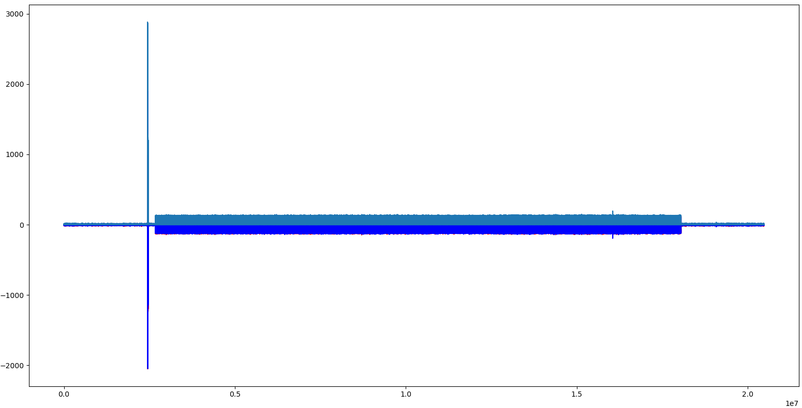
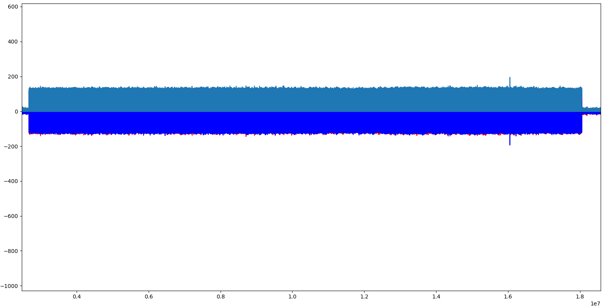
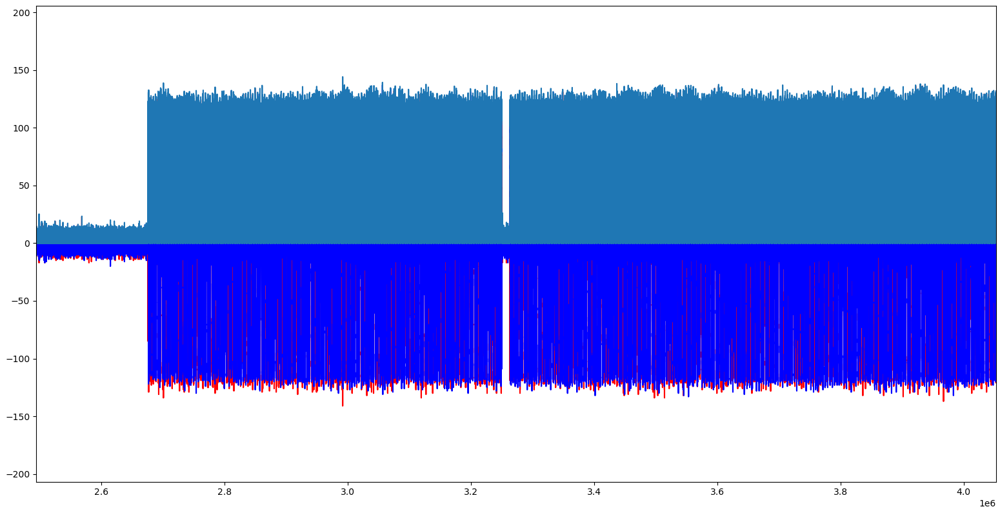
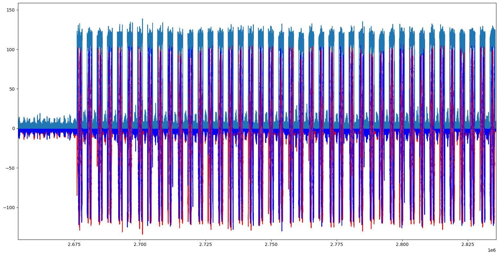
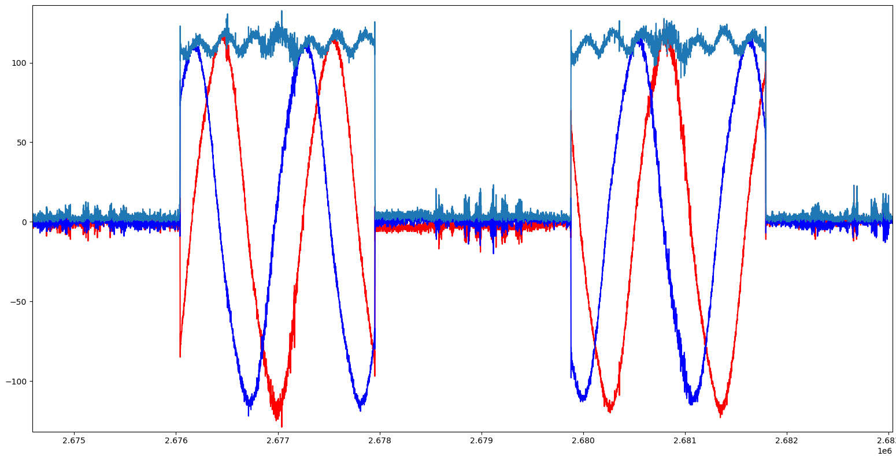

<div style="text-align: center; margin-top: 150px; margin-bottom: 250px;">
  <p style="font-size: 14px; text-transform: uppercase; letter-spacing: 2px;">Федеральное государственное образовательное бюджетное
учреждение высшего образования
«Сибирский государственный университет телекоммуникаций и
информатики» (ФГОБУ ВО «СибГУТИ»)</p>
  <h1 style="font-size: 36px; margin-top: 40px;">Отчет SDR №4 </h1>
  <p style="font-size: 18px; color: gray;">Передача IQ-отсчетов между двумя SDR-Adalm Pluto. </p>
</div>

<div style="text-align: right; margin-right: 50px;">
  <p><b>Выполнил:</b> Студент / Хоробров Георгий ИКС-433</p>
  <p><b>Проверил:</b> Преподаватель / Калачиков Александр Александрович</p>
</div>

<div style="text-align: center; margin-top: 150px;">
  <p>Новосибирск — 2026</p>
</div>

<div style="page-break-after: always;"></div>

---

### Выполнение работы:

На основе примеров передачи отсчетов написали программу работающая в двух режимах: `tx` и `rx`. Работающих на разных частотах: 800Мгц и 850Мгц.

Запуск:

```bash
SoapySDRUtil --find // Здесь находим нашу sdr и пишем конкретный usb при запуске

./sdr rx usb:1.5.5
или
./sdr tx usb:1.6.5
```

Код программы:

```cpp
#include <SoapySDR/Device.h>   // Инициализация устройства
#include <SoapySDR/Formats.h>  // Типы данных, используемых для записи сэмплов
#include <complex.h>
#include <stdint.h>
#include <stdio.h>   //printf
#include <stdlib.h>  //free
#include <string.h>  //strcmp

#include <csignal>

int freq1 = 800e6;
int freq2 = 850e6;

static volatile int stop = 0;  // stop signal
static void on_sigint(int) { stop = 1; }

SoapySDRDevice* make_device(const char* uri) {
  SoapySDRKwargs args = {};
  SoapySDRKwargs_set(&args, "driver", "plutosdr");
  SoapySDRKwargs_set(&args, "uri", uri);
  SoapySDRKwargs_set(&args, "direct", "1");  //
  SoapySDRKwargs_set(&args, "timestamp_every",
                     "1920");  // Размер буфера + временные метки
  SoapySDRKwargs_set(&args, "loopback", "0");  // Используем антенны или нет
  SoapySDRDevice* sdr = SoapySDRDevice_make(&args);  // Инициализация
  SoapySDRKwargs_clear(&args);
  return sdr;
}

int run(const char* uri, bool is_tx) {
  SoapySDRDevice* sdr = make_device(uri);

  int sample_rate = 2e6;
  int rx_freq = freq1;
  int tx_freq = freq2;
  const char* filename = "rxdata.pcm";

  if (is_tx) {
    rx_freq = freq2;
    tx_freq = freq1;
    filename = "txdata.pcm";
  }

  SoapySDRDevice_setSampleRate(sdr, SOAPY_SDR_RX, 0, sample_rate);
  SoapySDRDevice_setSampleRate(sdr, SOAPY_SDR_TX, 0, sample_rate);
  SoapySDRDevice_setFrequency(sdr, SOAPY_SDR_RX, 0, rx_freq, NULL);
  SoapySDRDevice_setFrequency(sdr, SOAPY_SDR_TX, 0, tx_freq, NULL);

  size_t channels[] = {0};
  SoapySDRDevice_setGain(sdr, SOAPY_SDR_RX, *channels, 45.0);
  SoapySDRDevice_setGain(sdr, SOAPY_SDR_TX, *channels, 45.0);
  size_t channel_count = sizeof(channels) / sizeof(channels[0]);

  SoapySDRStream* rxStream = SoapySDRDevice_setupStream(
      sdr, SOAPY_SDR_RX, SOAPY_SDR_CS16, channels, channel_count, NULL);
  SoapySDRStream* txStream = SoapySDRDevice_setupStream(
      sdr, SOAPY_SDR_TX, SOAPY_SDR_CS16, channels, channel_count, NULL);

  SoapySDRDevice_activateStream(sdr, rxStream, 0, 0, 0);
  SoapySDRDevice_activateStream(sdr, txStream, 0, 0, 0);

  size_t rx_mtu = SoapySDRDevice_getStreamMTU(sdr, rxStream);
  size_t tx_mtu = SoapySDRDevice_getStreamMTU(sdr, txStream);
  int16_t rx_buffer[2 * rx_mtu];
  int16_t tx_buff[2 * tx_mtu];

  const long timeoutUs = 400000;
  long long last_time = 0;
  FILE* file = fopen(filename, "w");
  size_t buffers_read = 0;

  for (int i = 2; i < 2 * tx_mtu; i += 2) {
    // ЗДЕСЬ БУДУТ ВАШИ СЭМПЛЫ
    tx_buff[i] = 666 << 4;      // I
    tx_buff[i + 1] = 777 << 4;  // Q
  }

  void* rx_buffs[] = {rx_buffer};
  signal(SIGINT, on_sigint);
  while (!stop) {
    int flags;
    long long timeNs = last_time;
    int sr = SoapySDRDevice_readStream(sdr, rxStream, rx_buffs, rx_mtu, &flags,
                                       &timeNs, timeoutUs);

    // Смотрим на количество считаных сэмплов, времени прихода и разницы во
    // времени с чтением прошлого буфера
    printf("Buffer: %lu - Samples: %i, Flags: %i, Time: %lli, TimeDiff: %lli\n",
           buffers_read, sr, flags, timeNs, timeNs - last_time);
    last_time = timeNs;

    long long tx_time = last_time + (4 * 1000 * 1000);  // на 4 [мс] в будущее

    for (size_t i = 0; i < 2; i++) {
      tx_buff[0 + i] = 0xffff;
      // 8 x timestamp words
      tx_buff[10 + i] = 0xffff;
    }

    // Переменная для времени отправки сэмплов относительно текущего приема
    // Добавляем время, когда нужно передать блок tx_buff, через tx_time
    // -наносекунд
    for (size_t i = 0; i < 8; i++) {
      uint8_t tx_time_byte = (tx_time >> (i * 8)) & 0xff;
      tx_buff[2 + i] = tx_time_byte << 4;
    }
    // заполнение tx_buff значениями сэмплов первые 16 бит - I, вторые 16 бит -
    // Q.

    // prepare fixed bytes in transmit buffer
    // that is a flag (FFFF FFFF) followed by the 64 bit timestamp, split into 8
    // bytes and packed into the lsb of each of the DAC words. DAC samples are
    // left aligned 12-bits, so each byte is left shifted into place

    // Здесь отправляем наш tx_buff массив
    void* tx_buffs[] = {tx_buff};
    if ((buffers_read % 2 == 0)) {
      printf("buffers_read: %d\n", buffers_read);
      flags = SOAPY_SDR_HAS_TIME;
      int st = SoapySDRDevice_writeStream(sdr, txStream,
                                          (const void* const*)tx_buffs, tx_mtu,
                                          &flags, tx_time, timeoutUs);
      if ((size_t)st != tx_mtu) {
        printf("TX Failed: %i\n", st);
      }
    }

    fwrite(rx_buffer, 2 * rx_mtu * sizeof(int16_t), 1, file);
    buffers_read++;
  }

  fclose(file);
  SoapySDRDevice_deactivateStream(sdr, rxStream, 0, 0);
  SoapySDRDevice_deactivateStream(sdr, txStream, 0, 0);
  SoapySDRDevice_closeStream(sdr, rxStream);
  SoapySDRDevice_closeStream(sdr, txStream);
  SoapySDRDevice_unmake(sdr);
}

int main(int argc, char* argv[]) {
  if (argc < 2) {
    printf("Использовать так: %s <rx|tx> [uri]\n", argv[0]);
    return 1;
  }
  const char* uri = "usb:6.6.6";
  if (argc > 2) {
    uri = argv[2];
  }
  if (strcmp(argv[1], "rx") == 0) {
    return run(uri, false);
  } else if (strcmp(argv[1], "tx") == 0) {
    return run(uri, true);
  } else {
    printf("Ошибка режима работы\n");
    return 1;
  }
}
```

### Результат










