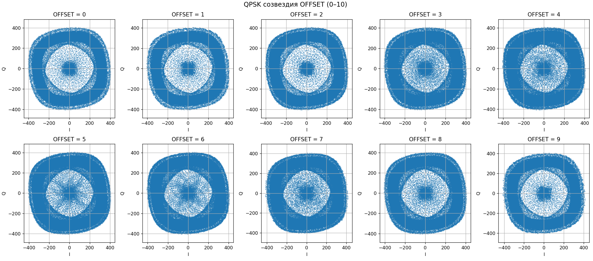
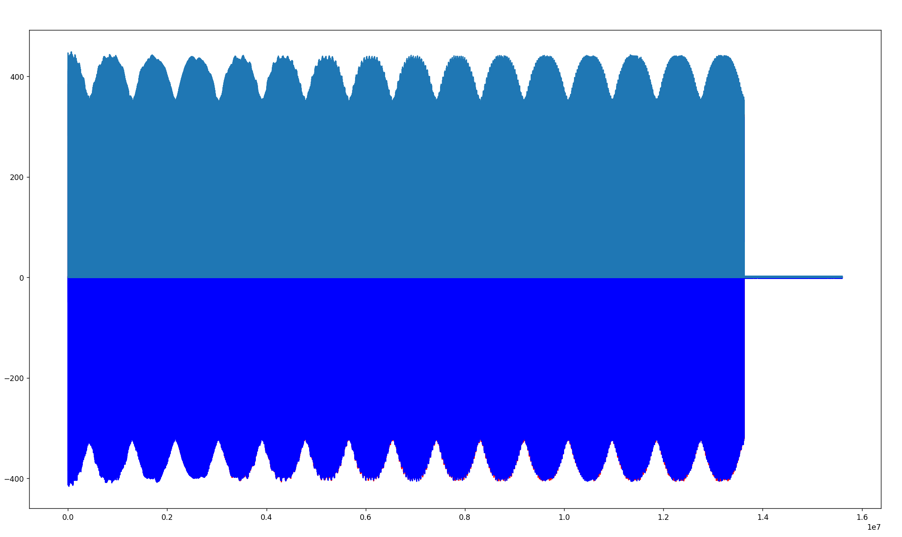
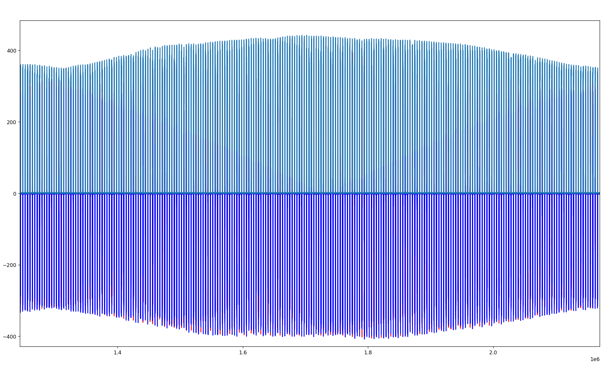
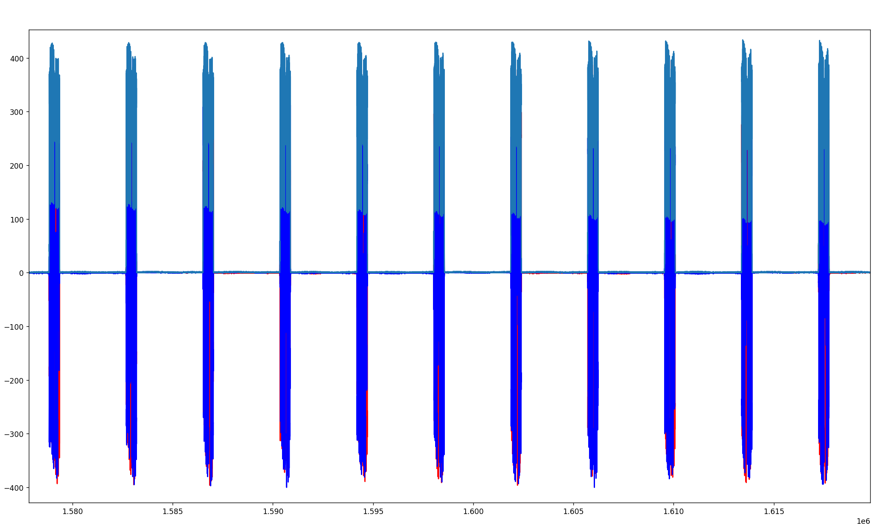
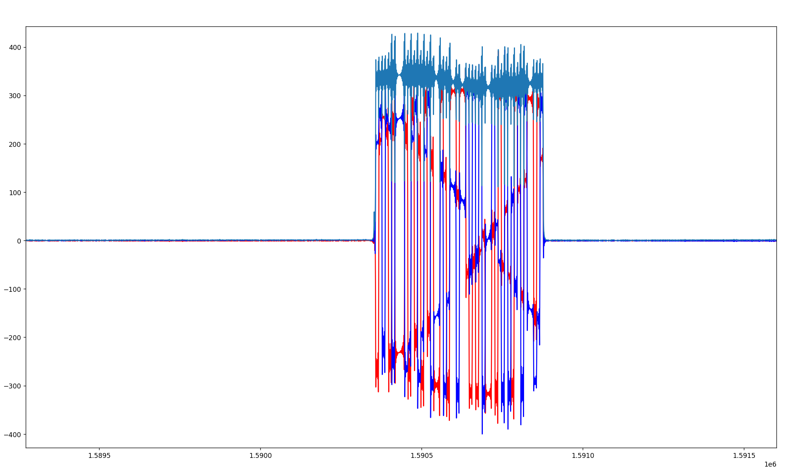
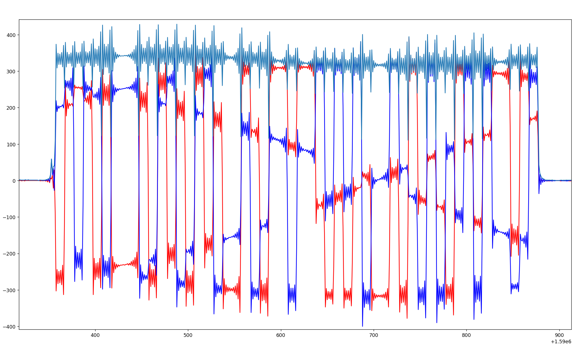

<div style="text-align: center; margin-top: 150px; margin-bottom: 250px;">
<div style="text-align: center; margin-top: 150px; margin-bottom: 250px;">
<div style="text-align: center; margin-top: 150px; margin-bottom: 250px;">
  <p style="font-size: 14px; text-transform: uppercase; letter-spacing: 2px;">Федеральное государственное образовательное бюджетное
учреждение высшего образования
«Сибирский государственный университет телекоммуникаций и
информатики» (ФГОБУ ВО «СибГУТИ»)</p>
  <h1 style="font-size: 36px; margin-top: 40px;">Отчет SDR №5 </h1>
  <p style="font-size: 18px; color: gray;">Передатчик: биты -> модуляция -> upsampling -> свертка -> TX. Начало приемника. </p>
</div>

<div style="text-align: right; margin-right: 50px;">
  <p><b>Выполнил:</b> Студент / Хоробров Георгий ИКС-433</p>
  <p><b>Проверил:</b> Преподаватель / Калачиков Александр Александрович</p>
</div>

<div style="text-align: center; margin-top: 150px;">
  <p>Новосибирск — 2026</p>
</div>

<div style="page-break-after: always;"></div></div></div>

---

### Выполнение работы:

Написал генерацию битов по строке. На передачу приемнику буду отправлять строку `Hello, worold!`.
Код:

```cpp
void genBits(std::vector<uint8_t>& bits) {
  std::string s = "Hello, world!";

  for (char c : s) {
    std::bitset<8> bitsChar(static_cast<unsigned char>(c));

    for (int i = 7; i >= 0; i--) {
      bits.push_back(bitsChar[i]);
    }
  }
}
```

Реализовал маппер `QPSK`:

```cpp
constexpr int TX_AMPLITUDE = 1000 << 4;
void map_qpsk(const std::vector<uint8_t>& bits, int16_t* buffer,
              size_t num_symbols) {
  for (size_t sym = 0; sym < num_symbols; sym++) {
    uint8_t b1 = bits[2 * sym], b2 = bits[2 * sym + 1];
    buffer[2 * sym] = b1 ? -TX_AMPLITUDE : TX_AMPLITUDE;
    buffer[2 * sym + 1] = b2 ? -TX_AMPLITUDE : TX_AMPLITUDE;
  }
}
```

Код свертки и upsampling:

```cpp
void upsample(const int16_t* in, int16_t* out, size_t num_symbols, size_t sps) {
  std::fill(out, out + 2 * num_symbols * sps, 0);
  for (size_t s = 0; s < num_symbols; s++) {
    out[2 * s * sps] = in[2 * s];
    out[2 * s * sps + 1] = in[2 * s + 1];
  }
}

void convolve(const int16_t* in, size_t n, const int16_t* h, size_t h_len,
              int16_t* out) {
  for (size_t i = 0; i < n; i++) {
    int32_t acc_i = 0, acc_q = 0;
    for (size_t k = 0; k < h_len && k <= i; k++) {
      acc_i += in[2 * (i - k)] * h[k];
      acc_q += in[2 * (i - k) + 1] * h[k];
    }
    out[2 * i] = static_cast<int16_t>(acc_i);
    out[2 * i + 1] = static_cast<int16_t>(acc_q);
  }
}
```

Теперь в буффер `tx_buff` складываем комплексные амплитуды.

```cpp
 std::vector<uint8_t> bits;
 constexpr size_t sps = 10;
  ...
  genBits(bits);
  size_t n_sym = bits.size() / 2;
  std::vector<int16_t> sym(2 * n_sym);
  std::vector<int16_t> up(2 * n_sym * sps);
  std::vector<int16_t> convolved(2 * n_sym * sps);

  map_qpsk(bits, sym.data(), n_sym);
  upsample(sym.data(), up.data(), n_sym, sps);

  std::vector<int16_t> h(sps, 1);
  convolve(up.data(), n_sym * sps, h.data(), h.size(), convolved.data());

  constexpr size_t header = 12;
  memset(tx_buff, 0, 2 * tx_mtu * sizeof(int16_t));
  size_t payload = std::min(convolved.size(), 2 * tx_mtu - header);
  std::copy(convolved.begin(), convolved.begin() + payload, tx_buff + header);
```

### Результат







